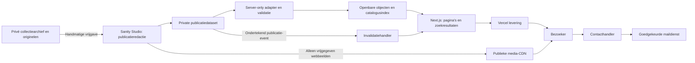
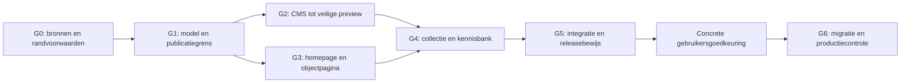

# MURANIQ — Architectuur voor een uitzonderlijke digitale privégalerie

Versie 1.0 · 9 november 2026 · Beslisdocument voor de latere bouw met Claude.

**De kernkeuze:** een Engelstalige privégalerie waarin echte kunstfotografie, controleerbaar onderzoek en eenvoudig collectiebeheer samenkomen. Eén Next.js-app op Vercel, een gerichte CMS-redactieomgeving en een strikt gescheiden openbare publicatielaag. De kwaliteit van de homepage en het individuele objectdossier bepaalt de kwaliteit van het hele platform.

Dit document specificeert de doelarchitectuur vóór implementatie. Voor “Claude Opus 5.5 — Extra” kiest de bouwopdracht de gedocumenteerde model-ID `claude-opus-5-5` en het inspanningsniveau `xhigh`, voor zover beschikbaar bij de provider. De opdrachten voor het ingebouwde `/goal` staan in de doelkaart. [Claude Code modelinstellingen](https://code.claude.com/docs/en/model-config) · [Claude Code Goals](https://code.claude.com/docs/en/goal).

## 1. Besluiten en prioriteiten

| Onderdeel | Gekozen richting | Waarom |
| --- | --- | --- |
| Product | Private gallery + onderzoeksarchief + discrete aanvragen | Past bij bestaande positionering en voorkomt webshopvormgeving |
| Identiteit | The Private Viewing Room: donkere kijkzaal, rustige collectiezaal, beige studieruimte | De wisseling ondersteunt kijken, kiezen en begrijpen |
| Inhoud | Vier categorieën, individuele objecten, makers, glashuizen, technieken en bronnen | Collectible Objects uit de bestaande site blijft behouden |
| Frontend | Next.js App Router, React Server Components, TypeScript strict | Publieke inhoud server-first; interactie alleen waar nodig |
| Vormgeving | Tailwind CSS met centrale CSS-designvariabelen | Eén consistent systeem zonder grote componentbibliotheek |
| Dagelijks beheer | Sanity Studio, ingericht voor MURANIQ | Honderden objecten toevoegen zonder React- of JSON-bestanden te bewerken |
| Publicatiedataset | Private dataset met alleen voor publicatie bestemde informatie | Toegang beheersen; vertrouwelijke collectieadministratie blijft erbuiten |
| Hosting | Vercel, GitHub voor versiebeheer en controle | Sluit aan op expliciete masterprompt; geen eigen VPS beheren |
| Zoeken | Compacte server-side index van openbare metadata | Geen grote catalogusdownload of betaalde AI-zoekdienst nodig |
| Interactie | Goede viewer en detailonderzoek eerst | Fotografie en bruikbaarheid leveren meer op dan verplichte 3D |
| Uitvoering | Afgebakende Goals, passende Alchemy-route en meetbaar bewijs | Gericht bouwen, geen eindeloze architectuurrondes |

De aanvullende audit stelt repositorycontent en eventueel VPS/Directus voor. Dat zijn alternatieven, geen cumulatieve eisen. Dit document kiest **Vercel** en **beheerd CMS** omdat de opdracht Vercel noemt en gemakkelijk dagelijks beheer benadrukt. Lokale JSON-fixtures blijven alleen voor ontwikkeling en tests. Geen parallelle productiebronnen in CMS, JSON en MDX.

Het kleurenpalet uit de oorspronkelijke masterprompt is leidend. De aanvullende audit versterkt het objectmodel, de kennisbank en migratieaanpak. De browserbevindingen staan apart in `01-BRONAUDIT-EN-MIGRATIE.md`; technische doelstellingen hieronder zijn geen metingen van de huidige site.

## 2. Bezoekers en productgrenzen

Drie primaire reizen bepalen de site:

1. **Ontdekken:** homepage → collectie/categorie → object → maker of verwant werk.
2. **Onderzoeken:** Glass Guide → techniek, maker of signatuur → gedocumenteerd voorbeeld → bron en onzekerheidsniveau.
3. **Informeren naar een werk:** object → aanvraag met objectreferentie → echte ontvangststatus → persoonlijke opvolging.

Release 1 bevat geen betaalproces, accounts, taxaties, automatische authenticiteitsbeoordeling, gebruikersuploads of verplichte 3D-omgeving. Een contactaanvraag kan algemeen zijn; alleen objecten met expliciet goedgekeurde beschikbaarheid krijgen acquisitietekst. “Private collection”, “Enquiries welcome”, “Reserved” en “Sold” zijn verschillende toestanden. Toon geen schaarste- of prijsclaims zonder echte gegevens.

**Succes betekent:** een bezoeker kan het werk goed bekijken, begrijpen wat werkelijk bekend is, relevante werken vinden en contact opnemen; de beheerder kan een nieuw dossier publiceren zonder een pagina te programmeren.

## 3. Informatiearchitectuur en URL-contract

Behoud trailing slashes voor aansluiting op de bezochte bestaande routes. Eén centrale routehelper maakt links, canonicals en breadcrumbs. Hieronder staat de gewenste structuur, geen claim dat de routes nu al bestaan.

| Route | Doel | Publicatie |
| --- | --- | --- |
| `/` | Gecureerde introductie | Release 1 |
| `/collection/` | Alle gepubliceerde werken, zoeken en filters | Release 1 |
| `/collection/murano-glass/` | Murano-categorie | Bestaand pad behouden |
| `/collection/studio-glass/` | Studio Glass | Bestaand pad; volwaardige inhoud vereist |
| `/collection/fine-art/` | Fine Art | Bestaand pad; volwaardige inhoud vereist |
| `/collection/collectible-objects/` | Collectible Objects | Bestaand pad; volwaardige inhoud vereist |
| `/collection/objects/[slug]/` | Individueel objectdossier | Release 1 |
| `/glass-guide/` | Kennisbank | Release 1 |
| `/glass-guide/makers/` en `/glass-guide/makers/[slug]/` | Makerindex en biografieën | Release 1 |
| `/glass-guide/glasshouses/[slug]/` | Fabriek/atelier | Bij voldoende broninhoud |
| `/glass-guide/techniques/[slug]/` | Techniek met echte voorbeelden | Release 1, beperkt maar compleet |
| `/glass-guide/signatures-labels/` | Referentiebeelden en duiding | Uitbreiding na catalogisering |
| `/glass-guide/attribution/` | Onderzoeksmethode en beperkingen | Release 1 |
| `/research/` en `/research/[slug]/` | Onderzoeksartikelen | Alleen met gereed artikel |
| `/exhibitions/[slug]/` | Gecureerde kijkroutes | Release 2 |
| `/compare/` en `/selection/` | Vergelijken en lokaal bewaren | Release 2; niet indexeren |
| `/about/`, `/contact/`, `/privacy/` | Achtergrond, contact en privacy | Release 1 |

Desktop toont Collection, Glass Guide, About en Contact als directe links; Search is herkenbaar. Het volledige menu bevat Home en de vier categorieën. Research krijgt een zichtbare ingang zodra er inhoud is. Op mobiel: logo, Search en Menu, met dezelfde informatiehiërarchie. Geen acht gelijkwaardige links in een krappe header.

Bij de uiteindelijke migratie krijgen `/arnaldo-zanella/` en `/loredano-rosin/` één permanente redirect naar hun nieuwe makerprofiel. Tot die omschakeling blijven de huidige pagina’s intact. `/about/` wordt een echte achtergrondpagina met opvallende contactlink; de huidige contactfunctie krijgt `/contact/`.

Ontbrekende categorie-inhoud wordt niet met verzonnen objecten gevuld. Behoud het oude pad met een eerlijke, nuttige introductie en verwijzing naar de beschikbare collectie; gebruik voorlopig `noindex` en neem het niet als lege galerij op in de hoofdontdekking. Zodra echte inhoud gereed is vervalt dit tijdelijke beleid.

## 4. Artistieke richting en design system

**The Private Viewing Room** gebruikt drie samenhangende ruimten:

- Kijkzaal: diep zwart, één groot werk, spaarzame tekst en volledige objectcontour.
- Collectiezaal: rustige ordening, duidelijke filters, grotere beelden dan interface-elementen.
- Studieruimte: warmbeige achtergrond voor langere beschrijvingen, techniek en bewijs.

### Tokens

| Token | Waarde | Gebruik |
| --- | --- | --- |
| `surface-stage` | `#080808` | Hoofdpodium |
| `surface-raised` | `#11100E` | Navigatie/panelen |
| `surface-paper` | `#E8DDCB` | Redactionele passages |
| `text-on-dark` | `#F5F0E7` | Primaire tekst op zwart |
| `text-muted-dark` | `#A59D91` | Secundaire tekst op zwart |
| `accent` | `#C5A46D` | Kleine accenten op donker |
| `accent-decoration` | `#A88A54` | Decoratieve details |
| `text-on-paper` | `#080808` | Tekst, links en focus op beige |

Goud is geen tekstkleur op beige: die combinatie haalt onvoldoende contrast voor gewone tekst. De 70/20/10-verhouding uit de brief is artistieke richting, geen quotum. Gebruik goud zo spaarzaam als de compositie vraagt. Controleer daadwerkelijke contrasten inclusief transparantie en fotografie.

Typografisch voorstel: Cormorant Garamond 500/600 voor titels, Inter 400/500 voor interface en lopende tekst. Controleer licenties en geleverde fontbestanden vóór gebruik. Host een beperkte WOFF2-set zelf. Body 17–18 px, regelhoogte 1,6, leesbreedte maximaal 65 tekens. Labels minimaal 13–14 px. Headlines vloeibaar circa 48–112 px desktop en 40–56 px mobiel, begrensd door inhoud en schermbreedte.

Raster: maximaal 1440 px, 12 kolommen desktop, 8 tablet, 4 mobiel. Marges 24 px mobiel, 40–72 px desktop, met kleinere marge waar 320 px dit vereist. Spatiëringsschaal 4/8/12/16/24/32/48/64/96/128 px. Objectpresentaties hebben geen decoratieve kaartschaduw; UI-panelen hoogstens kleine hoekafronding. Borders zijn functioneel en dun.

### Homepage als referentiepagina

1. Header circa 88 px desktop, 64 px mobiel. Merk herkenbaar, collectie direct bereikbaar.
2. Hero: tekst links op 5 kolommen, één echt werk rechts op 7. Rustig label, grote Engelse titel, korte introductie en één hoofdactie “Explore the collection”. Belangrijke tekst staat in HTML. Een bestaand logo- of campagnebeeld vervangt geen echte objectpresentatie.
3. Korte collectie-intro zonder verzonnen aantallen of reputatieclaims.
4. Selected works: maximaal drie goedgekeurde dossiers, asymmetrisch gepresenteerd. Minder als slechts één of twee volledig beschikbaar zijn.
5. Beige passage over glastechniek: één detailbeeld, beknopt verhaal en kennisbanklink.
6. Vier collectiegebieden in een redactionele compositie; inhoudelijk onvoltooide gebieden krijgen de hierboven beschreven terughoudende behandeling.
7. Onderzoek en herkomst: één overtuigend voorbeeld van een claim die naar bewijs leidt.
8. Uitnodiging, contact en compacte footer met uitsluitend echte profielen.

Mobiel wordt de hero label → titel → object → toelichting/actie. Geen geforceerde overlap; het werk behoudt zijn contour. De hero mag hoger worden dan één scherm. Geen verplichte intro, automatische carrousel, laadceremonie of scrollblokkade.

### Objectpagina als kwaliteitsanker

Desktop: ongeveer 62% beeld en 38% informatie. Links de hoofdfoto met echte alternatieven Front, Reverse, Base, Signature en Detail voor zover aanwezig. Rechts titel, zichtbare attributieformulering, periode, kerngegevens en passende contactactie. Op mobiel komen titel en attributie vóór de foto; kerngegevens volgen direct daarna.

De studieruimte bevat Description, Specifications, Marks & Labels, Attribution & Sources, Public Provenance, Condition en Related Works. Lege optionele secties worden weggelaten. Onbekende belangrijke waarden krijgen “Not documented”, geen opvulling. Een hypothese staat niet verscholen onder een titel die zekerheid suggereert.

Fullscreen opent pas na keuze. Thumbnailknoppen en een gewone afbeeldingenlijst blijven bruikbaar zonder geavanceerde gestures. Hotspots staan standaard uit en hebben een tekstuele lijst als alternatief. Maximaal drie verwante werken, met een begrijpelijke relatie zoals dezelfde gedocumenteerde techniek.

## 5. Systeemarchitectuur en verantwoordelijkheden



Eenrichtingsgrens: privéarchief → menselijke vrijgave → publicatiecontent. De publieke app heeft geen toegang tot aankoopprijzen, verzekeringswaarden, adressen, opslaglocaties of vertrouwelijke correspondentie. Ook de private CMS-publicatiedataset is geen algemene collectieadministratie.

Server Components renderen inhoud, metadata, breadcrumbs en objectlijsten. Client Components zijn kleine modules: menu, filterpaneel, viewer, optioneel lokaal bewaren en contactfeedback. Geen volledige client-side applicatie, globale statebibliotheek of aparte API-laag tussen eigen servercomponenten en eigen repository.

### Repository-indeling

```text
src/
  app/
    (gallery)/                 # publieke routepagina's uit het URL-contract
    api/contact/route.ts
    api/revalidate/route.ts
    api/draft/route.ts         # alleen bij beveiligde CMS-preview
    layout.tsx
    robots.ts
    sitemap.ts
    not-found.tsx
  features/
    catalog/                  # queryparser, filters, sortering, samenvattingen
    artworks/                 # dossier, viewer, annotaties
    guide/                    # makers, technieken, bronweergave
    enquiries/                # validatie, provideradapter, status
  components/
    layout/                   # header, footer, container
    ui/                       # button, dialog, field, focuspatronen
    editorial/                # beeld/tekstcomposities
  content/
    schemas/                  # domeinschema's en publicatieregels
    repository.server.ts      # klein leescontract
    sanity.server.ts          # expliciete CMS-projecties
    public-projection.ts      # allowlist: uitsluitend publieke velden
  lib/                        # routes, metadata, image-URL, logging
  styles/                     # tokens en global CSS
studio/                       # CMS-schema's en aangepaste redactieschermen
tests/                        # gedrags-, publicatie- en integratiechecks
fixtures/                     # herkenbare testdata, nooit productiecontent
scripts/                      # import, validatie, export, linkcontrole
docs/                         # dit pakket en later beslis-/kwaliteitsbewijs
public/                       # merkassets en vrijgegeven lokale fallbackbeelden
```

Maak mappen pas zodra er een module in hoort. Eén package/lockfile kan voor de eerste fase volstaan; maak geen monorepo-platform om één galerij te beheren. Studio wordt apart gebundeld en niet aan de publieke website geleverd. De site-eigenaar beheert gedeelde configuratie en dependencies bij parallel werk.

## 6. Collectiemodel en bewijsdiscipline

Gebruik stabiele interne identifiers los van slugs. Een foto is een asset; een werk is een object; een maker is een persoon of organisatie. De tien waargenomen medialinks bij twee makers bewijzen geen tien afzonderlijke werken.

| Entiteit | Verplichte kern en relaties |
| --- | --- |
| Artwork | ID, slug, titel, categorie, beschrijving, hoofdfoto, makersrollen, publicatiestatus, beschikbaarheid |
| Creator | Persoon/organisatie, naam, aliassen, biografie, rollen en bronnen |
| Glasshouse | Naam, locatie, actieve periode voor zover bekend, makersrelaties |
| Technique / Material | Voorkeursterm, synoniemen, uitleg en gekoppelde voorbeelden |
| Assertion | Onderwerp/veld, voorgestelde waarde, zekerheid, bewijsreferenties, publieke toelichting, reviewdatum |
| Source | Titel, type, auteur/organisatie, jaar, pagina/URL, rechten en betrouwbaarheidstoelichting |
| MediaAsset | ID, objectrelatie, zichttype, formaat, alttekst, caption, credit, rechten, focal point |
| Mark | Signatuur/label/pontil, observatie, transcriptie, detailbeeld, interpretatie apart |
| ProvenanceEvent | Publiceerbare gebeurtenis, datuminterval en bewijs |
| Collection / Exhibition | Gecureerde selectie, introductie, expliciete objectvolgorde |
| GuideArticle / ResearchArticle | Inhoud, auteur/reviewer, bronnen, revisiedatum, gekoppelde entiteiten |
| Redirect | Oud pad, nieuw pad, reden, controledatum |

Objecten ondersteunen verder land, geschatte productieperiode, materiaal, techniek, objecttype, kleur, afmetingen in mm, gewicht in gram, conditie en SEO-velden. Datering heeft `fromYear`, `toYear`, `displayLabel` en zekerheid. Onbekende maten blijven leeg; nul is geen onbekend. Bewaar zowel de betekenis van een inscriptie als de letterlijk waargenomen tekst, zonder automatische makerconclusie.

**Zekerheid hangt aan iedere bewering:** `verified`, `documented_attribution`, `probable`, `hypothesis`, `unknown`. Publicatieformuleringen zoals “Attributed to” en “Possibly by” blijven consistent in titel, filters, relaties en metadata. `verified` vereist benoemd bewijs en review; een signatuur alleen bewijst niet automatisch authenticiteit.

Het aanvullende document gebruikt vier attributielabels. Importeer deze met expliciete mapping; “documented” wordt niet blind “verified”. Bewaar bronstatus en reviewreden. Verlies onzekerheid niet door een technisch enum te vereenvoudigen.

De server valideert referenties, uniciteit, datumbereiken en publicatievelden. Voor publiceren vereist: begrijpelijke titel, categorie, één geschikt en vrijgegeven beeld, objectidentiteit, zichtbaar onzekerheidsniveau waar nodig en een rechtencontrole. Een minimum van zes werken is geen reden om gegevens te verzinnen. De eerste referentiepagina mag met één echt dossier starten.

## 7. CMS en redactiewerkwijze

De aanbevolen eindoplossing is **Sanity Growth met private dataset**. De geraadpleegde prijspagina vermeldt $15 per betaalde gebruiker per maand; gebruik en andere kosten kunnen bijkomen. Private datasets zijn niet inbegrepen bij Free. Controleer voorwaarden opnieuw bij aansluiting; dit document activeert geen abonnement. [Sanity-prijzen](https://www.sanity.io/pricing).

Waarom deze keuze: visueel bewerken, gestructureerde relaties, direct bruikbare media-infrastructuur en geen eigen CMS-serveronderhoud. Afweging: abonnement en leveranciersafhankelijkheid. Bewaar daarom exportbare gegevens en een onafhankelijke assetinventaris. Een publiek gratis datasetmodel is een mogelijke latere heroverweging, geen stille vervanging van de gekozen privacygrens.

Studio krijgt een objectlijst met miniatuur, collectie-ID, maker en status. Per dossier tabbladen Identity, Photography, Examination, Attribution, Sources en Publication. Redacteuren kunnen beelden ordenen, bronnen koppelen, onbekende gegevens markeren, preview openen en zien waarom publicatie wordt geblokkeerd. De acceptatietest is het toevoegen en corrigeren van een werk zonder codewijziging.

Sanity-drafts versus gepubliceerde documenten bepalen zichtbaarheid. Een aanvullend redactioneel `in_review`-label ondersteunt het proces, maar wordt geen tweede tegenstrijdig publicatiesysteem. Importers gebruiken dezelfde validatieregels als de server; Studio-validatie alleen is onvoldoende.

Productiequeries kiezen expliciet de `published`-weergave en een allowlist van velden. Draftpreview heeft afzonderlijke authenticatie, `no-store`, geen indexering en geen publieke zoekindex. Tokens blijven server-only. Een queryperspectief is geen authenticatiemechanisme. [Sanity Perspectives](https://www.sanity.io/docs/content-lake/perspectives).

Controleer datasettoegang bij aansluiting met een bekende testrecord. Een ongeauthenticeerde private query kan een leeg resultaat met HTTP 200 geven. Onderscheid daarom misconfiguratie van een werkelijk lege collectie. Gebruik voor echte redactie een duurzaam geconfigureerde private dataset. Sanity kan private proefdatasets na het aflopen van de trial publiek maken. [Sanity datasets](https://www.sanity.io/docs/content-lake/datasets).

**Cruciale mediagrens:** gewone Sanity-datasetassets zijn openbaar op de CDN, ook bij een private dataset. Upload alleen al vrijgegeven, opgeschoonde webbeelden. Geen privéoriginelen, interne rapporten of embargo-assets. Intrekken van een object verwijdert de bijbehorende asset niet automatisch. [Sanity assetbeheer](https://www.sanity.io/docs/content-lake/manage-assets).

Zonder aangesloten CMS bouwt Claude de adapter, Studio-schema's, publicatieregels en lokale preview met herkenbare fixtures. Het eindproduct wordt niet als compleet gepresenteerd voordat de echte redactieflow, preview, publicatie en export getest zijn.

## 8. Rendering, caching en zoeken

Exacte stabiele versies worden bij installatie geverifieerd en vastgezet. Geen canary-stack. De geraadpleegde Next-documentatie onderscheidt Cache Components van het vorige cachemodel. Kies **Cache Components** en documenteer de bijbehorende instellingen; mix niet ongecontroleerd `use cache` met oude routeconfiguraties. [Next.js caching](https://nextjs.org/docs/app/getting-started/caching).

| Pagina/data | Aanpak |
| --- | --- |
| Home, categorie-intro, gids, maker, object | Vooraf renderen waar mogelijk; gedeelde publieke data cachebaar |
| Zoek-/filterquery | URL verwerken op server; resultaten per aanvraag, catalogusdata hergebruiken |
| CMS-preview | Geauthenticeerd, dynamisch, niet publiek cachen |
| Contact en webhook | Dynamische POST-handler; geen antwoordcache |
| Afbeeldingen | Versioneerbare URLs, begrensde afmetingen en CDN |

Voor CMS-serverqueries begint `useCdn: false` naast de Next-cache helder: bij verversing de actuele bron ophalen. Cached readers hebben gerichte tags voor object, maker en catalogus. Een nieuwe makernaam, techniek, slug of publicatiestatus ververst ook de afhankelijke index en metadata.

Publicatie-webhook: controleer ondertekening op raw body, payloadgrootte, project/dataset en toegestane eventtypen. Gebruik een vaste servermapping naar tags. Herhaalde geldige events mogen dezelfde invalidatie uitvoeren; beloof geen exactly-once zonder duurzame opslag. Timestampcontrole en toegestane retryvertraging worden samen getest. Alleen een signatuurcheck bewijst geen recency.

Normale updates mogen stale-while-revalidate gebruiken. Voor intrekking of spoedcorrectie laat de handler de betrokken tags onmiddellijk verlopen en controleert de beheerder beide URL’s, de sitemap en zoekresultaten. Media intrekken volgt een afzonderlijke procedure, inclusief controle op directe CDN-URL’s. Cacheverversing via TTL gebeurt bij aanvragen. Test create, update, delete, gewijzigde referenties en eerder gecachete 404’s. [Next.js revalidatie](https://nextjs.org/docs/app/getting-started/revalidating), [Sanity-webhooks](https://www.sanity.io/docs/content-lake/webhooks).

### Zoekcontract

De collectie-URL is de bron van waarheid, bijvoorbeeld `/collection/?technique=sommerso&category=murano-glass&page=2`. Vraagtekst staat in `q`. Accepteer alleen bekende parameters; begrens querylengte, facetkeuzes en paginaomvang. Binnen een facet OR, tussen facetten AND. Datumbereiken vergelijken op overlap, met onbekende datering apart.

Een gecachte `getCatalogIndex()` haalt compacte openbare samenvattingen op en maakt een deterministische zoekstructuur op de server. Titel/maker-ID/exacte naam wegen zwaarder dan alias, techniek en beschrijving. Beheerde synoniemen en accentnormalisatie helpen; geen AI-authenticatie of verzonnen makerrelaties.

Resultaten zijn 24 werken per pagina met stabiele sortering en een ID als laatste sorteersleutel. Standaard curated; andere sortering alleen op beschikbare waarden. Paginering gebruikt gewone links. GET-formulieren werken als basis; JavaScript verbetert filterbediening en focus. Terug/vooruit herstelt keuzes. Mobiele filters hebben een resultaatgetal en expliciete apply/reset.

De browser ontvangt alleen benodigde resultaten en facetwaarden. Meet bij een groeiende collectie serverlatency, geheugen en indexgewicht voordat een externe zoekdienst wordt toegevoegd. Een vast aantal objecten alleen is geen migratiecriterium.

## 9. Fotografie, viewer en beweging

Bewaar fotografische originelen buiten de publieke site. Het mediaproces registreert bronbestand, rechten, object-ID, zichttype, checksum en afgeleiden. Webexport behoudt betrouwbare kleurweergave, verwijdert locatie-EXIF en kiest sRGB als gecontroleerde standaard. Beoordeel banding, reflecties en transparantie visueel; een klein bestand is geen voldoende kwaliteitstest.

Gebruik Sanity's afbeeldingslevering als gekozen transformatielaag, met passende `srcset`/`sizes` en eventueel een gecontroleerde Next-image-loader. Voorkom dubbele optimalisatie via zowel Sanity als Vercel. Lokale merkbeelden kunnen de standaard Next-image-route gebruiken. Hero-afbeelding direct laden, hieronder lazy; bekende breedte/hoogte voorkomt layoutsprongen. [Next Image-documentatie](https://nextjs.org/docs/app/api-reference/components/image).

Startafmetingen voor afgeleiden: 480/768/1200/1800 px, alleen wat de weergave nodig heeft. Zoomdetails worden pas op aanvraag geleverd, bijvoorbeeld tot 2400–3200 px als de bron en rechten dit toelaten. Dit zijn ingestelde richtlijnen, geen reden om beelden groter te maken dan het origineel.

Viewer: originele verhouding, zoom/reset, vorige/volgende, caption, zichtbare sluitknop, Escape, focusherstel en toegankelijke naam. Touch-, drag- en pinchgedrag hebben knopalternatieven. Hotspots gebruiken genormaliseerde coördinaten op de ongecropte foto. Lichtstudies gebruiken echte verschillende opnamen met labels; 360° vereist een echte volledige fotoserie of model. Geen gegenereerde achterzijde of gesimuleerde historische signatuur.

CSS-transities zijn de basis. Voeg hoogstens één animatiebibliotheek toe wanneer een concreet patroon CSS overstijgt. Geen GSAP én Motion én WebGL als standaardset. Feedback circa 120–180 ms, panelen 220–320 ms, optionele beeldreveal 450–600 ms. Hero en leesbare tekst wachten niet op JavaScript of animaties. Reduced motion krijgt directe toestandswissels; native scroll blijft intact.

## 10. Innovatie met concrete prioriteit

H = hoog, M = middel, L = laag. Kosten zijn relatieve ontwikkel- en beheerinspanning, geen offertes. Alle functies blijven afhankelijk van geschikte echte broninhoud.

| Functie | Waarde / beeldimpact | Complexiteit / performancekosten | Beheer / financiële kosten | Moment |
| --- | --- | --- | --- | --- |
| Glass Explorer: echte detailhotspots | H / H | M / L, extra beeld op verzoek | M / L | Release 1, beperkt voorbeeld |
| Evidence Trail: claim → foto/bron → uitleg | H / M | M / L | H redactioneel / L technisch | Eerste uitbreiding |
| Scale Desk: twee werken op relatieve maatlat | H / M | M / L met SVG | L bij betrouwbare maten / L | Release 2 |
| Three-Minute Viewing: drie werken rond één techniek | H voor nieuwkomer / H | L–M / L | M curatorieel / L | Release 2 |
| Detail Index: visuele eigenschap → techniek en voorbeelden | H / H | M / M door beelden | M–H tagging / L–M | Na voldoende macrobeelden |
| Uncertainty Lens: bewezen jaren versus geschatte intervallen | M–H / M | M / L | M onderzoek / L | Bij vergelijken |

Scale Desk toont relatieve afmetingen, geen gegarandeerde fysieke grootte op een onbekend scherm. Visuele overeenkomst in Detail Index is geen bewijs van maker of herkomst. Evidence Trail benoemt ook wanneer een bron slechts aanwijzingen geeft.

Vergelijken omvat precies twee werken in de eerste versie. Persoonlijke selectie bewaart alleen openbare object-ID’s lokaal, met wissen en uitleg; geen account. Immersive Gallery hergebruikt een gecureerde selectie, met normale navigatie en terugkeer. Timelines zijn eerst toegankelijke gebeurtenissenlijsten; visuele tijdlijn is verrijking. 3D, 360° en echte lichtsimulatie blijven aparte latere besluiten met fotobudget en aantoonbare waarde.

## 11. SEO, contact en beveiliging

De primaire origin is `https://muraniq.nl`. `.com`, `www` en HTTP worden pas na controle van eigendom en configuratie permanent naar die origin geleid met padbehoud. Behoud bestaande afbeeldingslinks of leg een concrete mapping vast. Geen blanket redirect naar home. Preview krijgt toegangsbeveiliging én `noindex`; robotsregels vervangen geen beveiliging.

Iedere inhoudspagina heeft één duidelijke H1, unieke titel/beschrijving, absolute canonical, passende OG-afbeelding en interne links. Publicatiegegevens genereren de sitemap. Alleen zinvolle pagina’s indexeren. Zoek- en gecombineerde filterresultaten krijgen `noindex` en een genormaliseerde canonical; paginering zonder filters blijft expliciet bereikbaar en heeft een eigen canonical. Blokkeer noindexpagina’s niet tegelijk zodat crawlers de instructie nooit kunnen lezen.

Engels is release-1-taal: `lang="en"`, inclusief formulieren, navigatie en systeemmeldingen. Geen schijnvertalingen of hreflang zonder echte vertaalde pagina’s. Schema.org: `VisualArtwork` waar passend, `Person`/`Organization`, `Article`, `BreadcrumbList`. Geen ongekwalificeerde creatorclaim bij onzekere attributie en geen fictieve `Offer`, beoordelingen of prijzen. [VisualArtwork](https://schema.org/VisualArtwork).

Contactvelden: naam, e-mailadres, bericht en optionele openbare objectreferentie. De server controleert formaat, lengte, objectreferentie en misbruik. Betrouwbare beperkingen moeten meerdere serverinstanties dekken; een lokale Map is geen sluitende rate limiter. Kies bij aansluiting één maildienst met domeinverificatie; bestemming blijft serverconfiguratie. Maak fout- en timeouttoestanden echt. “Accepted” betekent door provider geaccepteerd, niet gegarandeerd ontvangen; controleer bezorging voor de lanceringscheck. Zonder mailintegratie toont de site eerlijk de bestaande e-maillink, geen nepformulierbevestiging.

Veiligheid: server-only secrets, gevalideerde rich text, geen uitvoerbare externe MDX, beperkte image-originallowlist, veilige JSON-LD-serialisatie, logredactie en dependency-updates. Geen querytekst of contactberichten in analytics. Privacytekst en bewaartermijnen moeten overeenkomen met werkelijk gebruik; verzin geen bedrijfsgegevens.

CSP krijgt een expliciet implementatiebesluit. Per-request nonces vereisen dynamische rendering; beloof niet tegelijkertijd overal statische pagina’s en per-request nonces. Test een passende statische policy of kies bewust dynamische routes waar nodig. Voeg overige headers toe en toets formulieren/viewer/preview op regressies. [Next.js CSP](https://nextjs.org/docs/app/guides/content-security-policy).

## 12. Meetbare kwaliteit en operationele eisen

| Aspect | Doel / acceptatie |
| --- | --- |
| Core Web Vitals | p75 LCP ≤ 2,5 s; INP ≤ 200 ms; CLS ≤ 0,1, mobiel/desktop apart |
| Lighthouse | Streef ≥95 per categorie op representatieve productiebuild; afwijkingen verklaren |
| Initiële mobiele pagina | Richtbudget ≤1 MB gecomprimeerde overdracht tot eerste viewport, inclusief hero |
| Initiële JavaScript | Richtbudget ≤180 KB gzip incl. framework per referentieroute; meet en motiveer |
| Hero | Richtbudget 200–450 KB mobiel; behoud objectkwaliteit |
| Fonts | Richtbudget ≤150 KB voor werkelijk gebruikte eerste-viewfonts |
| Zoekresultaat | Richtdoel warme serverreactie p95 <500 ms op representatieve dataset; cold apart |
| Toegankelijkheid | WCAG 2.2 AA als norm; handmatig toetsenbord/schermlezer naast automatisering |
| Redactie | Werk aanmaken, foto ordenen, preview, publiceren en corrigeren zonder code |
| Privacy | Geen interne velden/EXIF in HTML, RSC, metadata, assets, exports of zoekindex |

Prestatiegetallen zijn projectbudgetten en doelen, geen gemeten resultaten. Labmetingen voorspellen geen gegarandeerde echte p75. Lighthouse meet geen volledige conformiteit. [Web Vitals](https://web.dev/articles/vitals), [WCAG 2.2](https://www.w3.org/TR/WCAG22/).

Visuele QA: 320, 390, 768 en 1440 px; 200% tekstzoom en 400% reflow; korte en lange titels; onbekende maker; ontbrekend detailbeeld; geen resultaten. Touchdoelen als ontwerpregel minimaal 44×44 px. Focus zichtbaar op donker en beige, geen essentiële hoveractie, geen afgeknipte objecten of bodytekst over onrustige fotografie.

Noodzakelijke automatische checks: typecheck, lint, build, contentvalidatie, unitchecks op filters/toeschrijvingen, integratiechecks op publicatiegrens/webhook en E2E van collectie → dossier → viewer → aanvraag. Test inputfouten en providerfouten. Gebruik betekenisvolle tests; geen snapshots van iedere triviale presentatieregel.

Bedrijfsvoering: afzonderlijke preview en productieconfiguratie; geen echte mail uit tests. Log storingen met request-ID zonder inhoudelijke persoonsgegevens. Controleer beschikbaarheid, 404’s, formulieracceptatie en cachefouten. Exporteer content en mediaregister vóór migratie en daarna volgens vastgelegd schema; voer een herstelproef uit. Hosting is geen archiefbackup.

Vercel Hobby is volgens de geraadpleegde voorwaarden voor persoonlijk niet-commercieel gebruik. Door mogelijke acquisitie mag gratis geschiktheid niet worden aangenomen. Begroot passend hostingplan, CMS-gebruik, beelden, mail en domeinen; activeer niets betaald zonder opdracht. [Vercel Hobby](https://vercel.com/docs/plans/hobby). Kostenmeldingen en eventuele limieten worden gecontroleerd ingesteld; een bedrag invullen stopt gebruik niet vanzelf. [Spend Management](https://vercel.com/docs/spend-management).

## 13. Bouwvolgorde en releasepoort

De gedetailleerde doelen staan in `04-GOALS.md`. De samenhang is:



G2 en G3 kunnen deels parallel zodra het datacontract vaststaat. Externe accounttoegang mag onafhankelijke lokale bouw niet stilleggen. Onvolledige externe integraties blijven wel expliciet open. Het toevoegen van animatie, 360° of meer pagina’s is geen oplossing voor een geblokkeerde publicatiegrens.

Voor omschakeling vereist: herstelbare backup van huidige site, complete URL/media-mapping, echte collectiegegevens, werkende CMS-redactie, geteste contactflow, visuele referentiecontrole, toegankelijke hoofdreizen, aantoonbaar schone publieke output en terugvalplan. Daarna pas expliciete productieautorisatie. DNS en huidige hosting blijven tot dat moment ongemoeid.

De nieuwe site wordt niet opgeleverd als een verzameling lege luxe pagina’s. Iedere zichtbare bestemming levert de beloofde inhoud of een eerlijke bruikbare beperkte toestand. Het opleverrapport maakt onderscheid tussen gebouwd, daadwerkelijk getest, inhoudelijk nog te controleren en afhankelijk van externe aansluiting.

## 14. Status van dit architectuurpakket

Gereed: openbare broninspectie van tien routes, analyse van beide aangeleverde plannen, architectuurbesluiten, designrichting, datamodel, URL-contract, CMS-keuze, integratiestrategie, kwaliteitscriteria en Claude-overdracht met Goals. Alchemy-bronnen zijn onderzocht voor die overdracht; geen installatie of volledige Alchemy-codeaudit uitgevoerd.

Nog niet gedaan: nieuwe websitebouw, objectidentificatie, rechtencontrole van alle beelden, historische verificatie, hosting-/CMS-inrichting, formuliertest, productiebenchmark of deployment. Voor originele biografieën en media blijft de bestaande site bronmateriaal, geen automatisch bewijs van historische juistheid.
