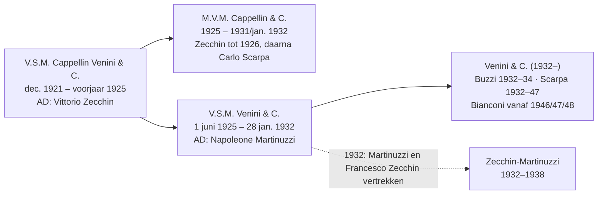
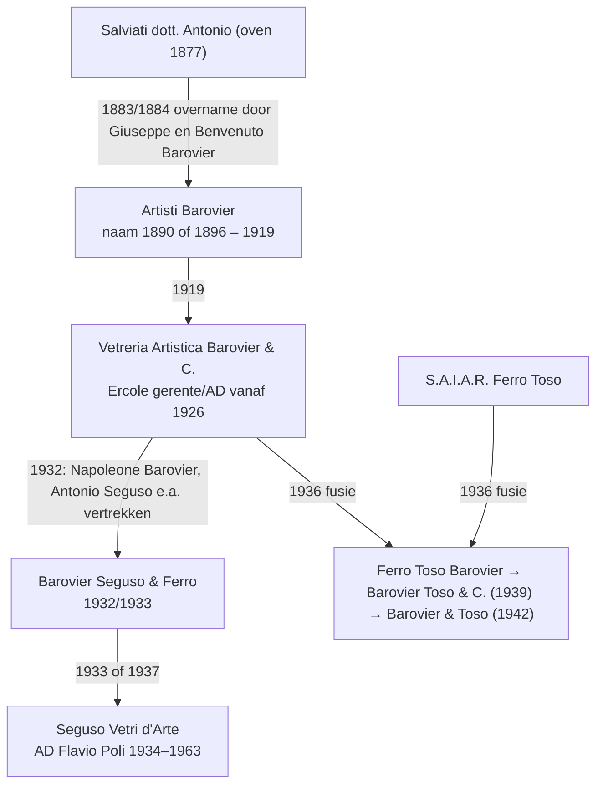

# D — Historische relaties

Onderzoeksdatum: 2026-11-10 · Status: Phase 1, eerste levering · Volledige tabel: [D-relationship-table.md](D-relationship-table.md) · Data: `data/relationships.json`

Dit document beschrijft de relaties tussen families, ontwerpers, maestri en glasblazerijen, met nadruk op de negen casussen uit de opdracht. Elke bewering verwijst naar een relatie-ID (`REL-…`) of een claim (`CLM-…`) in de dataset; daar staan de bronnen en vindplaatsen. Waar bronnen elkaar tegenspreken staat de conflictgroep (`CF-…`) erbij; die zijn uitgewerkt in [F-conflict-register.md](F-conflict-register.md).

## Spelregels die hier zijn toegepast

1. **Familie is niet hetzelfde als zakelijk.** Een familieband (`CHILD_OF`, `SIBLING_OF`, `MEMBER_OF_FAMILY`) is alleen vastgelegd als een bron hem noemt, en zegt niets over zakelijke banden. Een zakelijke of professionele relatie (`FOUNDED`, `PARTNER_IN`, `ARTISTIC_DIRECTOR_OF`, `DESIGNED_FOR` enz.) is alleen vastgelegd als een bron die relatie zelf noemt.
2. **Een gedeelde achternaam bewijst niets.** Toso, Ferro, Barbini, Nason, Zanetti, Seguso en Moretti zijn grote Muranese families met veel aparte bedrijven. Zonder bron staat er geen relatie in de data.
3. **Homoniemen krijgen elk een eigen ID**, en waar verwarring dreigt een expliciete `NOT_SAME_AS`-relatie (bijv. Angelo Barovier 15e eeuw en Angelo Barovier geb. 1927; Vittorio en Francesco Zecchin).
4. **Onopgeloste namen** (een merknaam die misschien een persoon, een bedrijf of een handelsetiket is) staan als `IDENTITY_UNRESOLVED`, niet als samengevoegd record.

## Casus 1 — De Seguso-takken

Er is niet één "Seguso". De bronnen laten minstens vier afzonderlijke bedrijven zien:

| Bedrijf | Wie | Periode | Status | Relaties |
|---|---|---|---|---|
| Artistica Vetreria e Soffieria Barovier Seguso & Ferro → Seguso Vetri d'Arte | o.a. Antonio Seguso, Napoleone Barovier, maestri uit de Vetreria Artistica Barovier; Archimede, Ernesto en Alberto Seguso | 1932/1933 → naam Seguso Vetri d'Arte 1933 of 1937 | DISPUTED (datum) | REL-0049–0052, REL-0057; CF-BSF-FOUNDING, CF-BSF-RENAME |
| Vetreria Artistica Archimede Seguso | Archimede Seguso; later zoon Gino en kleinzoon Antonio | 1946– | VERIFIED | REL-0059–0061 |
| Seguso Viro | Giampaolo Seguso (zoon van Archimede) met zijn zonen | 1993– | PARTIALLY_VERIFIED (alleen bedrijfsbron) | REL-0062–0063 |
| "Arte Vetro" van Alberto Seguso | Alberto Seguso; Napoleone Martinuzzi werkte er vanaf 1947 vijf jaar | jaren 1940–50 | PARTIALLY_VERIFIED | REL-0065–0066 |

Familie: Archimede is zoon van de maestro Antonio Seguso, die vennoot was in de Vetreria Artistica Barovier (REL-0048, REL-0053). Volgens de bedrijfsgeschiedenis van Seguso Vetri d'Arte waren ook Angelo, Ernesto, Bruno en Isidoro zonen van Antonio (REL-0054, REL-0055, alleen bedrijfsbron). Angelo Seguso was tot 1973 hoofdmaestro van Seguso Vetri d'Arte (REL-0064).

Niet vastgesteld: de relatie van **Livio Seguso** (geb. 1930), **Gianni Seguso** / firma *Seguso Gianni* en het label *Seguso Arte Vetro* tot deze takken. Die staan als aparte records met status UNVERIFIED of `IDENTITY_UNRESOLVED` (REL-0136–0138). De familieclaim "sinds 1397, 23 generaties" is een bedrijfsclaim (CLM in `FAM-SEGUSO`) en geen geverifieerd feit.

## Casus 2 — Scarpa, Cappellin en Venini

- Eind 1921 richten Giacomo Cappellin en Paolo Venini (met Luigi Ceresa en Emilio Ochs) V.S.M. Cappellin Venini & C. op, in de oven van de in augustus 1921 overleden Andrea Rioda; Vittorio Zecchin wordt artistiek directeur (REL-0001–0003; DBI Cappellin, DBI Venini, DBI Zecchin).
- In 1925 gaan de vennoten uit elkaar. Daaruit ontstaan **twee** opvolgers: Cappellins M.V.M. Cappellin & C. en Venini's V.S.M. Venini & C. (REL-0004, REL-0005).
- **Carlo Scarpa** werkt voor M.V.M. Cappellin tot de sluiting (REL-0008). Wanneer hij begint en wanneer hij artistiek directeur wordt, verschilt per bron: 1925–26 (DBI Scarpa), 1926 (Le Stanze del Vetro), eind 1926 (Olnick Spanu), 1927–28 (DBI Cappellin) — **CF-SCARPA-CAPPELLIN-START**. Ook de sluiting van M.V.M. Cappellin is 1931 of januari 1932 (**CF-MVM-CLOSURE**).
- Bij V.S.M. Venini & C. zijn Napoleone Martinuzzi en de ingenieur **Francesco** Zecchin vennoten; Martinuzzi is artistiek directeur (REL-0009–0012). Martinuzzi's vertrek valt in 1931 of 1932 (**CF-MARTINUZZI-VENINI-END**). Na de liquidatie op 28 januari 1932 gaat het bedrijf verder als Venini & C. (REL-0013).
- Scarpa werkt van 1932 tot 1947 voor Venini (REL-0015, VERIFIED). Dat hij vanaf 1934 de titel artistiek directeur had, staat alleen bij Olnick Spanu (REL-0016, PARTIALLY_VERIFIED, **CF-SCARPA-VENINI-AD**).
- Let op het homoniem **Vittorio vs. Francesco Zecchin** (REL-0093): Vittorio (schilder) was AD bij Cappellin Venini en daarna kort bij M.V.M. Cappellin; Francesco (ingenieur) was vennoot van Venini en richtte met Martinuzzi Zecchin-Martinuzzi op. Eén Olnick Spanu-pagina is hierover dubbelzinnig (**CF-ZECCHIN-HOMONYM**).
- Latere Venini-ontwerpers met bron: Buzzi, Bianconi, Tobia Scarpa (zoon van Carlo, REL-0018), Stearns, Wirkkala, Zuccheri, Vignelli, Ponti, Licata (REL-0014–0029). Ludovico Diaz de Santillana, schoonzoon van Paolo Venini, leidde het bedrijf na 1959 (REL-0023–0024).

## Casus 3 — Dino Martens en Aureliano Toso

- Martens was midden jaren twintig kort vennoot en decorateur bij S.A.L.I.R. (REL-0078), ontwierp daarna voor Salviati & C. en Successori Andrea Rioda (REL-0079–0080; Le Stanze del Vetro Biennale 1932–42 bevestigt beide) en werd in 1939 artistiek directeur van **Vetri Decorativi Rag. Aureliano Toso** (REL-0081).
- Einde: 1963 volgens de Martens-pagina en 1965 volgens de Aureliano Toso-pagina van dezelfde bron (**CF-MARTENS-TOSO-END**). Oprichtingsjaar van Aureliano Toso: 1938 in de tekst, 1932 in de paginakop (**CF-AURELIANO-TOSO-FOUNDING**).
- Het Met-object 1986.436.11 is "Attributed to Dino Martens" (`WRK-MET-484659`, status ATTRIBUTED). Gebruik voor dit soort objecten op de website altijd "toegeschreven aan".
- **Aureliano Toso is niet hetzelfde bedrijf als Fratelli Toso.** Een familieband tussen Aureliano Toso en de stichters van Fratelli Toso staat in geen enkele gelezen bron.

## Casus 4 — Alfredo Barbini vóór zijn eigen bedrijf

Volgens Olnick Spanu (enige gelezen bron voor de stappen, dus PARTIALLY_VERIFIED):

1. maestro op ca. 17-jarige leeftijd, eerst bij Cristalleria Franchetti, daarna bij S.A.I.A.R. Ferro Toso (REL-0084);
2. na 1932 bij Zecchin-Martinuzzi, samenwerking met Napoleone Martinuzzi tot 1936 (REL-0085);
3. 1937 vennoot en primo maestro bij V.A.M.S.A. (REL-0086);
4. 1946 vennoot en artistiek directeur van het nieuwe Gino Cenedese & C. (REL-0087–0088); met Cenedese op de Biënnale van 1948 (Le Stanze del Vetro noemt voor de Biënnales 1948–1958 zowel de nieuwe oven Gino Cenedese als de werkplaats van Alfredo Barbini);
5. 1950 eigen oven, Vetreria Alfredo Barbini (REL-0089, VERIFIED). De paginakop "1932–" bij hetzelfde bedrijf is waarschijnlijk zijn loopbaanbegin, maar dat is een interpretatie (**CF-BARBINI-FIRM-FOUNDING**).

Zoon Flavio werkt vanaf 1968 mee (REL-0090). Een collectorsite noemt in 1945 een samenwerking met Archimede Seguso; niet geverifieerd. Het label **AAV Barbini** is niet verklaard en is niet aan Vetreria Alfredo Barbini gekoppeld (REL-0139).

## Casus 5 — Barovier, Seguso en Ferro

- De gebroeders Giuseppe en Benvenuto Barovier werkten bij de Compagnia di Venezia e Murano en volgden in 1877 Antonio Salviati naar zijn nieuwe oven; zij namen die oven in 1883 (DBI; Olnick Spanu Giuseppe) of 1884 (Olnick Spanu Artisti Barovier) over (**CF-BAROVIER-TAKEOVER**). De naam *Artisti Barovier* dateert van 1890 (OS) of 1896 (DBI) (**CF-ARTISTI-BAROVIER-NAME**).
- In 1919 volgt de Vetreria Artistica Barovier & C., in 1936 de fusie met S.A.I.A.R. Ferro Toso tot wat vanaf 1942 Barovier & Toso heet (REL-0045, REL-0067–0068). Ercole Barovier is er artistiek directeur tot 1972, daarna zijn zoon Angelo (REL-0069–0070).
- De afsplitsing van 1932: Napoleone Barovier en Antonio Seguso (vennoot in de Vetreria Artistica Barovier) richten met anderen Barovier Seguso & Ferro op (REL-0048–0052). DBI noemt 1932, Olnick Spanu 1933 (**CF-BSF-FOUNDING**).
- Wie "Ferro" in die naam is, staat niet in de gelezen bronnen. De Ferro van S.A.I.A.R. Ferro Toso, de Ferro's van A.VE.M. (Antonio Luigi, Egidio, Galliano) en Giorgio Ferro mogen dus **niet** aan elkaar of aan Barovier Seguso & Ferro gekoppeld worden zonder nieuwe bron.
- Angelo Barovier (15e eeuw, cristallo) en Angelo Barovier (geb. 1927) zijn verschillende personen (REL-0031). Een doorlopende stamboom van de 13e/15e-eeuwse Baroviers naar het moderne bedrijf is een bedrijfsclaim ("since 1295") en niet gereconstrueerd.

## Casus 6 — Flavio Poli en Seguso Vetri d'Arte

- Vittorio Zecchin was kort artistiek directeur van Barovier Seguso & Ferro; Poli volgde hem in 1934 op en bleef tot 1963 (REL-0072, REL-0074, VERIFIED). Bij de reorganisatie van 1937 werd Poli ook vennoot (REL-0075, alleen OS).
- Vóór 1934 werkte Poli volgens Olnick Spanu o.a. voor I.V.A.M., de Compagnia di Venezia e Murano, Nason en Francesconi (REL-0076).
- Na Poli werd Mario Pinzoni artistiek directeur (REL-0077); Maurizio Albarelli leidde het bedrijf vanaf begin jaren zestig (OS; nog geen record).
- Het belangrijkste werk in deze relatie werd uitgevoerd door Archimede Seguso als primo maestro (REL-0058) — ontwerper en uitvoerder zijn dus verschillende rollen, en de dataset houdt `designer_ids` en `maker_ids` gescheiden.
- Compasso d'Oro 1954 voor Poli's vaas is een bedrijfsclaim, nog te controleren bij ADI.

## Casus 7 — Gino Cenedese en Antonio (Nini) Da Ros

- Gino Cenedese & C. werd in 1946 opgericht met Alfredo Barbini als vennoot en artistiek directeur (REL-0087–0088, REL-0094).
- Da Ros als artistiek directeur vanaf 1958 of 1959 staat alleen in Tier C-bronnen (REL-0095, UNVERIFIED, **CF-DAROS-START**). Er is wel één museumtoeschrijving: Met 1986.436.10, "Attributed to Nini DaRos; Manufacturer: Gino Cenedese" (REL-0096, ATTRIBUTED).
- De handelaarsclaim dat Walter Furlan in 1940–45 bij Cenedese werkte, kan niet kloppen met de oprichting in 1946 (REL-0097, DISPUTED, **CF-FURLAN-CENEDESE**). Ook de "Picasso-licentie" rond Furlan/Badioli is niet aangetoond.
- De relatie tussen Gino Cenedese en het huidige Cenedese (Simone Cenedese) is niet vastgesteld.

## Casus 8 — Oggetti: handelshuis, geen glasblazerij

Oggetti (Miami, opgericht 1975) beschrijft zichzelf als bedrijf dat stukken betrekt van kunstenaars en ambachtslieden wereldwijd (`ORG-OGGETTI`, entity_type **Distributor**, bron: eigen site, Tier C). Gevolgen voor de data en de website:

- Een "Oggetti"-label of -catalogus noemt de verkoper of het merk, niet de producent. Een object met alleen een Oggetti-label krijgt geen `workshop_ids`; alleen als het label of een document de oven noemt, komt die erbij.
- Er zijn bewust geen relaties tussen Oggetti en Muranese ovens vastgelegd: de gelezen bron noemt geen leveranciers.
- Voor de website: Oggetti hoort niet in de lijst glasblazerijen, maar bij "distributors & brands".

## Casus 9 — Toso, Ferro, Barbini, Nason, Zanetti: zelfde naam, verschillende bedrijven

| Achternaam | Afzonderlijke entiteiten in de data | Vastgestelde verbanden | Niet vastgesteld |
|---|---|---|---|
| **Toso** | Fratelli Toso (1854–1982), Vetri Decorativi Rag. Aureliano Toso, S.A.I.A.R. Ferro Toso → Barovier & Toso, Toso Vetri d'Arte (1980/81–1990) | Fratelli Toso gesticht door zes broers Toso (REL-0098); Ermanno Toso AD en vennoot (REL-0099–0100); Rosanna en Giusto Toso ontwierpen voor Fratelli Toso (REL-0102–0103) | Of Aureliano Toso, de Toso van Ferro Toso en de Toso's van Toso Vetri d'Arte familie zijn van Fratelli Toso; huidige status van de naam Fratelli Toso (CF-FRATELLI-TOSO-STATUS) |
| **Ferro** | A.VE.M. (1932), Galliano Ferro (1955), S.A.I.A.R. Ferro Toso, Barovier Seguso & Ferro, Ferro & Lazzarini, Ferro Murano | A.VE.M. opgericht door Antonio Luigi Ferro, zoon Egidio, Emilio Nason, Galliano Ferro, Giulio Radi (REL-0105–0108); Giorgio is zoon van Galliano (REL-0112) en volgde hem in 1955 naar Galliano Ferro (REL-0114–0116) | Verwantschap tussen Antonio Luigi en Galliano Ferro; wie de Ferro's van Ferro Toso en Barovier Seguso & Ferro zijn; Ferro & Lazzarini en Ferro Murano (geen bron) |
| **Barbini** | Vetreria Alfredo Barbini, label AAV Barbini | Alfredo → zoon Flavio (REL-0090) | Andere Barbini-ovens; betekenis "AAV Barbini" |
| **Nason** | Nason & Moretti (1923 of 1925), V. Nason & C.; Emilio Nason (A.VE.M.); Ermanno Nason | Emilio Nason medeoprichter A.VE.M. (REL-0107) | Familieverband tussen de Nason-bedrijven; oprichters Nason & Moretti (CF-NASON-MORETTI-FOUNDING) |
| **Zanetti** | Zanetti Murano; Licio en Oscar Zanetti | — | Alles; en let op: Abate Vincenzo Zanetti (stichter Museo del Vetro, 1861) is een andere context |
| **Moretti** (extra) | Vincenzo Moretti (19e-eeuwse murrine), Ercole Moretti, Carlo Moretti (1958) | Vincenzo Moretti werkte bij de Venezia-Murano Company (REL-0124) | Verwantschap tussen deze Moretti's; DBI "Vincenzo Moretti" is een kardinaal (homoniem, geen glasmaker) |

## Overige lijnen in de data

- **Salviati**: drie bedrijven met bijna dezelfde naam — de mozaiekfirma van 1859, de Londense Salviati & C. van 1866 (later Venice and Murano / Compagnia di Venezia e Murano) en de Muranese oven van 1877 die in 1883/84 aan de Barovier's overging (REL-0038, REL-0120–0123; **CF-SALVIATI-C-FOUNDING**, **CF-SALVIATI-1877-NAME**). Welke van deze het huidige Salviati voortzet, is nog een open vraag.
- **Compagnia di Venezia e Murano → Pauly & C.**: in 1919 samen verkocht, in 1920 door Gaetano Ceschina overgenomen (REL-0125). De Met schrijft een kan van ca. 1860–70 "mogelijk" toe aan Pauly, vóór de oprichting van Pauly in 1902/03 (**CF-PAULY-FOUNDING**).
- **Vistosi**: Guglielmo Vistosi (1945), daarna broer Oreste en neven Gino en Luciano; ontwerpers Pianon, Bianconi, Aulenti, Sottsass (REL-0129–0133). Het historische bedrijf sloot volgens Olnick Spanu begin jaren negentig; het merk Vistosi bestaat vandaag onder een andere eigenaar volgens een bedrijfsprofiel dat alleen via de zoekindex is gezien (**CF-VISTOSI-CONTINUITY**).
